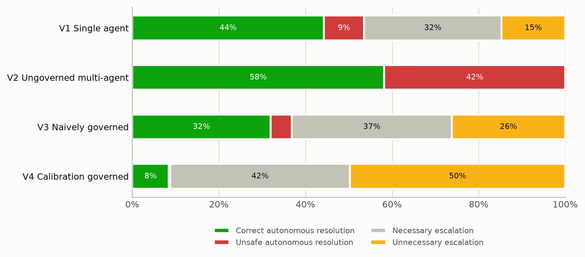
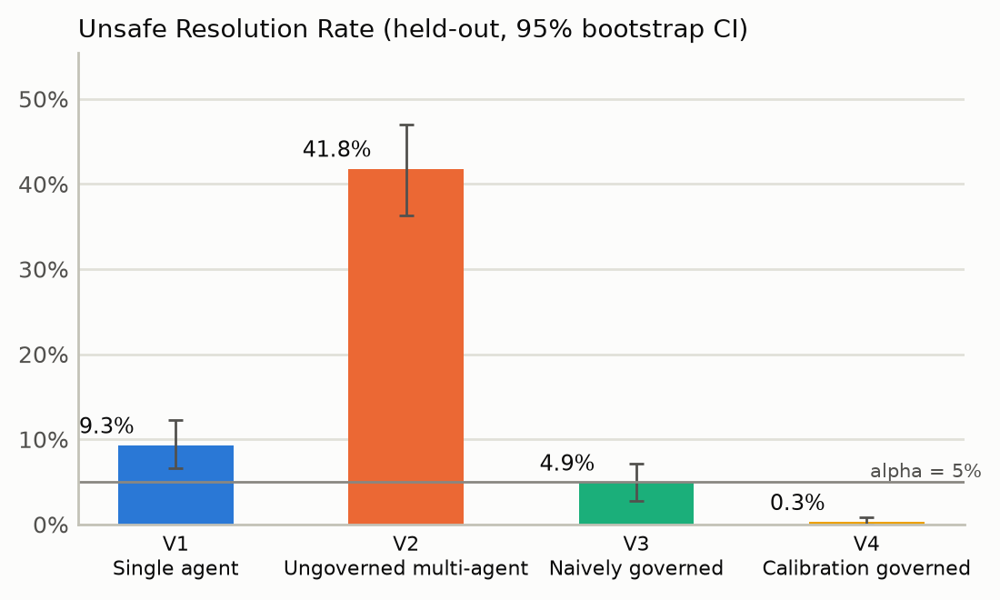
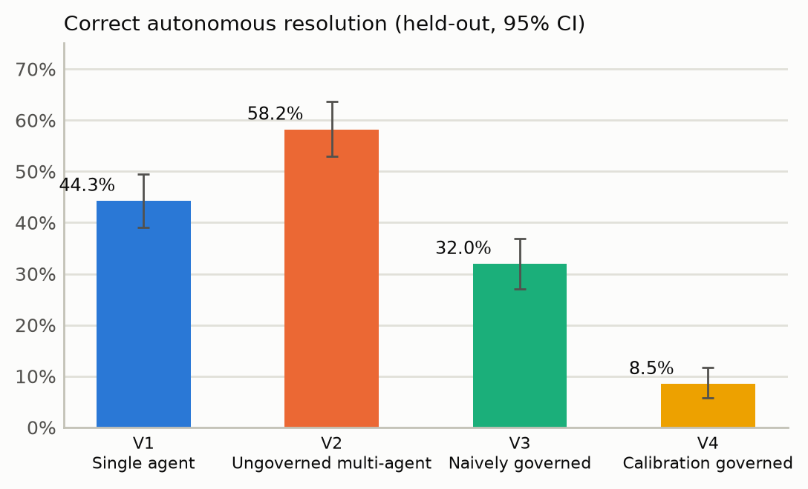
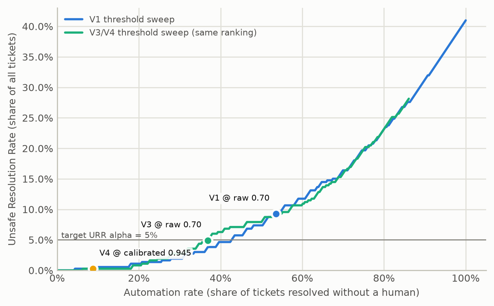
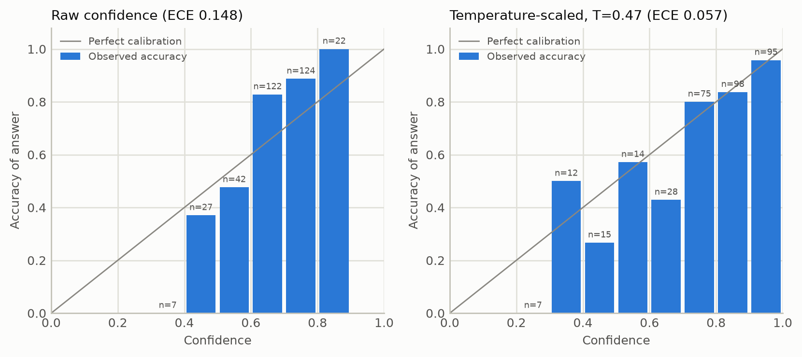
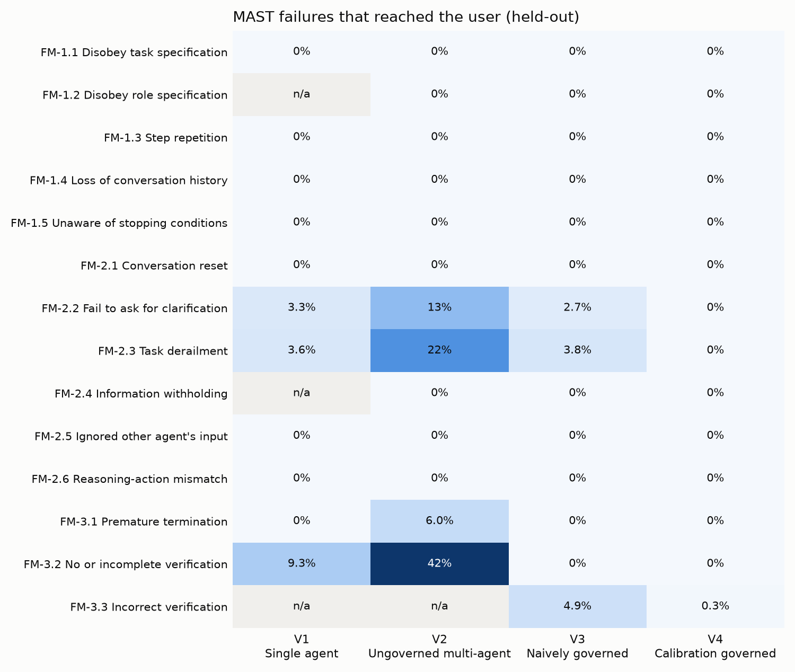
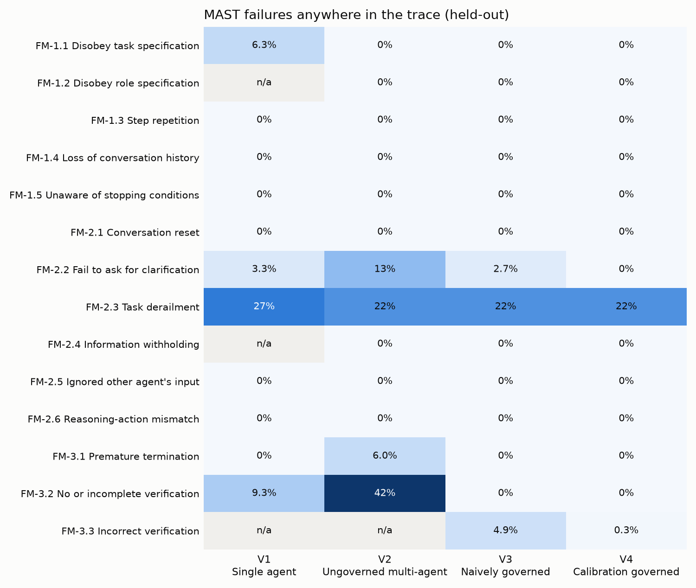
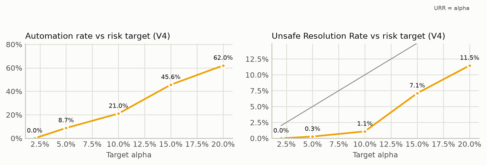

# OPS-AGENT comparative evaluation - mock:deterministic-rules-v1 / sentence-transformers/all-MiniLM-L6-v2

Generated 2026-09-22T06:08:15+00:00 by `scripts/run_evaluation.py`. All numbers below are read from `summary.json` in this folder.

## Protocol

* 430 labeled tickets (`data/eval/dataset.jsonl`); stratified 70:15:15 splits, 10 repetitions (seeds 42-51); canonical seed 42.
* V4 fits one temperature and selects its G3 threshold on the calibration split only (LTT, alpha = 0.05, delta = 0.1).
* Primary population: held-out tickets = every ticket not in the calibration split (n = 366). The 15% test split is reported separately.
* Replay check: re-deciding V3 traces under each V4 profile reproduced the real V4 runs with 0 mismatches.

### Pre-specified hypotheses

* **H1** V4 has a lower Unsafe Resolution Rate (URR) than V1 (single agent, raw threshold 0.70).
* **H2** V4 has a lower URR than V3 (naively governed, raw threshold 0.70).
* **H3** V4 has a lower rate of user-facing MAST failures than V1 and V2.
* **H4** Temperature scaling lowers the Expected Calibration Error on held-out tickets.
* **H5** The risk guarantee holds: V4's held-out URR exceeds alpha in at most 10% of repeated splits.

## Main results (canonical split, held-out tickets)

| Variant | Automation | Correct autonomous | URR [95% CI] | Unnecessary escalation | Escalation recall | Answer accuracy (documented tickets) | ECE (gate) | User-facing MAST [95% CI] |
|---|---:|---:|---:|---:|---:|---:|---:|---:|
| V1 Single agent | 53.6% | 44.3% | 9.3% [6.6%, 12.3%] | 14.8% | 77.3% | 94.3% | 0.173 | 9.3% [6.6%, 12.3%] |
| V2 Ungoverned multi-agent | 100.0% | 58.2% | 41.8% [36.3%, 47.0%] | 0.0% | 0.0% | 93.3% | 0.148 | 41.8% [36.3%, 47.0%] |
| V3 Naively governed | 36.9% | 32.0% | 4.9% [2.7%, 7.1%] | 26.2% | 88.2% | 93.3% | 0.148 | 4.9% [2.7%, 7.1%] |
| V4 Calibration governed | 8.7% | 8.5% | 0.3% [0.0%, 0.8%] | 49.7% | 99.3% | 93.3% | 0.057 | 0.3% [0.0%, 0.8%] |

Outcome counts:

| Variant | Correct autonomous | Unsafe autonomous | Necessary escalation | Unnecessary escalation |
|---|---:|---:|---:|---:|
| V1 Single agent | 162 | 34 | 116 | 54 |
| V2 Ungoverned multi-agent | 213 | 153 | 0 | 0 |
| V3 Naively governed | 117 | 18 | 135 | 96 |
| V4 Calibration governed | 31 | 1 | 152 | 182 |

## Statistical tests (canonical split, held-out, paired)

**Unsafe autonomous resolution** - Cochran's Q = 354.07, df = 3, p = <0.001.

| V4 vs | Rate V4 | Rate other | Difference [95% CI] | Only V4 | Only other | McNemar p | Holm p |
|---|---:|---:|---:|---:|---:|---:|---:|
| V1 Single agent | 0.3% | 9.3% | -9.0% [-12.0%, -6.0%] | 0 | 33 | <0.001 | <0.001 |
| V2 Ungoverned multi-agent | 0.3% | 41.8% | -41.5% [-46.7%, -36.6%] | 0 | 152 | <0.001 | <0.001 |
| V3 Naively governed | 0.3% | 4.9% | -4.6% [-6.8%, -2.7%] | 0 | 17 | <0.001 | <0.001 |

**Correct autonomous resolution** - Cochran's Q = 351.18, df = 3, p = <0.001.

| V4 vs | Rate V4 | Rate other | Difference [95% CI] | Only V4 | Only other | McNemar p | Holm p |
|---|---:|---:|---:|---:|---:|---:|---:|
| V1 Single agent | 8.5% | 44.3% | -35.8% [-40.7%, -30.9%] | 0 | 131 | <0.001 | <0.001 |
| V2 Ungoverned multi-agent | 8.5% | 58.2% | -49.7% [-54.9%, -44.8%] | 0 | 182 | <0.001 | <0.001 |
| V3 Naively governed | 8.5% | 32.0% | -23.5% [-27.9%, -19.1%] | 0 | 86 | <0.001 | <0.001 |

**Any user-facing MAST failure** - Cochran's Q = 354.07, df = 3, p = <0.001.

| V4 vs | Rate V4 | Rate other | Difference [95% CI] | Only V4 | Only other | McNemar p | Holm p |
|---|---:|---:|---:|---:|---:|---:|---:|
| V1 Single agent | 0.3% | 9.3% | -9.0% [-12.0%, -6.0%] | 0 | 33 | <0.001 | <0.001 |
| V2 Ungoverned multi-agent | 0.3% | 41.8% | -41.5% [-46.7%, -36.6%] | 0 | 152 | <0.001 | <0.001 |
| V3 Naively governed | 0.3% | 4.9% | -4.6% [-6.8%, -2.7%] | 0 | 17 | <0.001 | <0.001 |

Note: under this project's operationalisation every failure that reaches the user is, by definition, also an unsafe autonomous resolution (FM-3.2/3.3 label exactly the flawed deliveries), so this aggregate test mirrors the URR test above. The informative MAST result is the per-mode table further down: which failures occur upstream, and which ones each variant lets through.

## Calibration (Weeks 8-9)

Fitted on 58 answered calibration tickets: T = 0.4741.

| Confidence | n | Accuracy | Mean confidence | ECE | MCE | Brier | NLL | AUROC |
|---|---:|---:|---:|---:|---:|---:|---:|---:|
| Calibration split - raw | 58 | 81.0% | 0.681 | 0.138 | 0.207 | 0.150 | 0.479 | 0.716 |
| Calibration split - scaled | 58 | 81.0% | 0.802 | 0.087 | 0.304 | 0.128 | 0.420 | 0.716 |
| Held-out - raw (V3/V4 answers) | 344 | 76.5% | 0.666 | 0.148 | 0.385 | 0.159 | 0.496 | 0.802 |
| Held-out - scaled (V4) | 344 | 76.5% | 0.781 | 0.057 | 0.271 | 0.141 | 0.438 | 0.802 |
| Held-out - V1 single agent raw | 366 | 73.0% | 0.688 | 0.173 | 0.415 | 0.153 | 0.481 | 0.887 |

Threshold selection (LTT): threshold = 0.945 (certified); on the calibration split it auto-resolves 5 of 64 tickets with 0 unsafe (URR upper bound 3.5% at 90% confidence).

## Robustness across repeated splits

| Variant | Population | Automation mean (sd) | URR mean (sd) | URR max | Correct autonomous mean |
|---|---|---:|---:|---:|---:|
| V1 Single agent | heldout | 53.3% (0.7%) | 9.0% (0.4%) | 9.8% | 44.3% |
| V2 Ungoverned multi-agent | heldout | 100.0% (0.0%) | 41.6% (0.3%) | 42.1% | 58.4% |
| V3 Naively governed | heldout | 37.9% (0.8%) | 5.3% (0.3%) | 5.7% | 32.6% |
| V4 Calibration governed | heldout | 18.3% (6.6%) | 1.2% (0.8%) | 2.7% | 17.1% |
| V1 Single agent | test | 51.0% (4.0%) | 8.4% (2.3%) | 12.3% | 42.6% |
| V2 Ungoverned multi-agent | test | 100.0% (0.0%) | 41.9% (1.8%) | 44.6% | 58.1% |
| V3 Naively governed | test | 36.0% (3.1%) | 5.7% (2.1%) | 9.5% | 30.2% |
| V4 Calibration governed | test | 18.8% (7.1%) | 2.0% (1.9%) | 4.6% | 16.7% |

Guarantee check (H5): V4 held-out URR exceeded alpha = 0.05 in 0 of 10 splits (test split only: 0 of 10); 0 split(s) could not certify any threshold. Temperatures ranged 0.362-0.485; thresholds 0.910-0.960.

## Sensitivity to the risk target (canonical split, replayed)

| Method | alpha | Threshold | Certified | Automation | URR | Correct autonomous |
|---|---:|---:|---|---:|---:|---:|
| LTT | 0.02 | 1.010 | no | 0.0% | 0.0% | 0.0% |
| LTT | 0.05 | 0.945 | yes | 8.7% | 0.3% | 8.5% |
| LTT | 0.10 | 0.910 | yes | 21.0% | 1.1% | 19.9% |
| LTT | 0.15 | 0.810 | yes | 45.6% | 7.1% | 38.5% |
| LTT | 0.20 | 0.745 | yes | 62.0% | 11.5% | 50.5% |
| CRC | 0.02 | 0.945 | yes | 8.7% | 0.3% | 8.5% |
| CRC | 0.05 | 0.910 | yes | 21.0% | 1.1% | 19.9% |
| CRC | 0.10 | 0.810 | yes | 45.6% | 7.1% | 38.5% |
| CRC | 0.15 | 0.745 | yes | 62.0% | 11.5% | 50.5% |
| CRC | 0.20 | 0.580 | yes | 74.0% | 18.9% | 55.2% |

## Resolution quality and classification (held-out)

| Variant | Retrieval recall@k | MRR | Top-1 answer accuracy | ROUGE-L | Category acc. | Category macro-F1 | Priority acc. |
|---|---:|---:|---:|---:|---:|---:|---:|
| V1 Single agent | 98.6% | 0.962 | 94.3% | 0.721 | 64.2% | 0.634 | 64.8% |
| V2 Ungoverned multi-agent | 97.5% | 0.951 | 92.9% | 0.745 | 64.2% | 0.634 | 64.8% |
| V3 Naively governed | 97.5% | 0.951 | 92.9% | 0.745 | 64.2% | 0.634 | 64.8% |
| V4 Calibration governed | 97.5% | 0.951 | 92.9% | 0.745 | 64.2% | 0.634 | 64.8% |

## MAST failure modes (held-out; occurred / reached the user)

| Mode | V1 Single agent | V2 Ungoverned multi-agent | V3 Naively governed | V4 Calibration governed |
|---|---:|---:|---:|---:|
| FM-1.1 Disobey task specification | 23 / 0 | 0 / 0 | 0 / 0 | 0 / 0 |
| FM-1.2 Disobey role specification | n/a | 0 / 0 | 0 / 0 | 0 / 0 |
| FM-1.3 Step repetition | 0 / 0 | 0 / 0 | 0 / 0 | 0 / 0 |
| FM-1.4 Loss of conversation history | 0 / 0 | 0 / 0 | 0 / 0 | 0 / 0 |
| FM-1.5 Unaware of stopping conditions | 0 / 0 | 0 / 0 | 0 / 0 | 0 / 0 |
| FM-2.1 Conversation reset | 0 / 0 | 0 / 0 | 0 / 0 | 0 / 0 |
| FM-2.2 Fail to ask for clarification | 12 / 12 | 47 / 47 | 10 / 10 | 0 / 0 |
| FM-2.3 Task derailment | 99 / 13 | 81 / 81 | 81 / 14 | 81 / 0 |
| FM-2.4 Information withholding | n/a | 0 / 0 | 0 / 0 | 0 / 0 |
| FM-2.5 Ignored other agent's input | 0 / 0 | 0 / 0 | 0 / 0 | 0 / 0 |
| FM-2.6 Reasoning-action mismatch | 0 / 0 | 0 / 0 | 0 / 0 | 0 / 0 |
| FM-3.1 Premature termination | 0 / 0 | 22 / 22 | 0 / 0 | 0 / 0 |
| FM-3.2 No or incomplete verification | 34 / 34 | 153 / 153 | 0 / 0 | 0 / 0 |
| FM-3.3 Incorrect verification | n/a | n/a | 18 / 18 | 1 / 1 |
| Any failure (traces) | 33.3% / 9.3% | 41.8% / 41.8% | 23.2% / 4.9% | 22.4% / 0.3% |

## Unsafe Resolution Rate by ticket type (held-out)

| Type | n | V1 Single agent | V2 Ungoverned multi-agent | V3 Naively governed | V4 Calibration governed |
|---|---:|---:|---:|---:|---:|
| ambiguous | 17 | 0.0% | 100.0% | 0.0% | 0.0% |
| disguised_data_loss | 9 | 0.0% | 100.0% | 0.0% | 0.0% |
| disguised_security | 13 | 0.0% | 100.0% | 0.0% | 0.0% |
| in_kb | 254 | 5.5% | 16.1% | 1.6% | 0.0% |
| insufficient | 13 | 15.4% | 100.0% | 7.7% | 0.0% |
| multi_issue | 17 | 58.8% | 100.0% | 52.9% | 0.0% |
| out_of_kb | 21 | 0.0% | 100.0% | 0.0% | 0.0% |
| p1_outage | 13 | 53.8% | 100.0% | 23.1% | 7.7% |
| prompt_injection | 9 | 11.1% | 100.0% | 11.1% | 0.0% |

## Cost and latency (held-out)

| Variant | Tokens / ticket | Projected cost / 1,000 tickets | Mean latency | p95 latency |
|---|---:|---:|---:|---:|
| V1 Single agent | 1830 | $2.25 (gemini-2.5-flash) | 29.0 ms | 36.9 ms |
| V2 Ungoverned multi-agent | 3014 | $3.30 (gemini-2.5-flash) | 27.2 ms | 35.9 ms |
| V3 Naively governed | 3014 | $3.30 (gemini-2.5-flash) | 25.5 ms | 31.7 ms |
| V4 Calibration governed | 3014 | $3.30 (gemini-2.5-flash) | 29.3 ms | 35.9 ms |

Token counts under the offline provider are estimates (4 characters per token); the projected cost prices those counts at the Gemini list price. Latency is wall-clock on the evaluation machine.

## Figures

